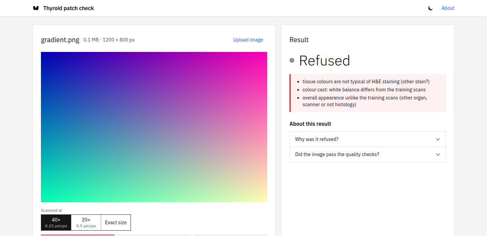
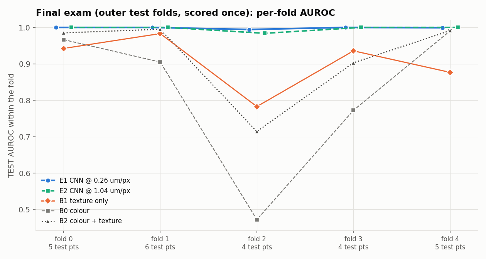
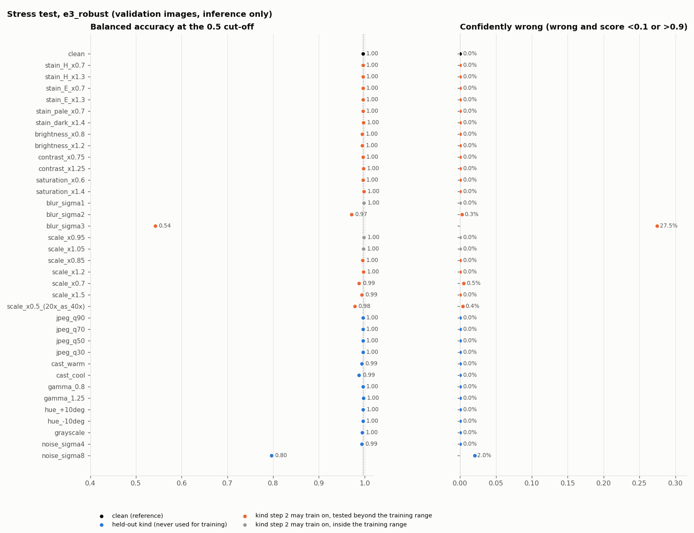
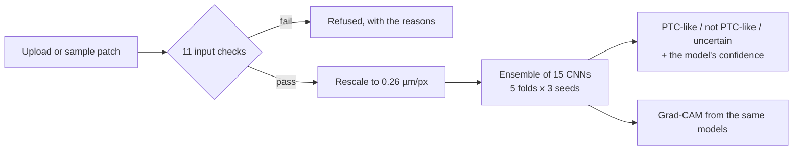

# PTIC thyroid patch classifier

A leakage-safe deep-learning pipeline, a small CNN, a safety gate and a web demo for classifying H&E-stained thyroid tissue patches
as **PTC-like** (papillary thyroid carcinoma) or **non-PTC-like**, built on the public
[PathoTiroid Dataset Indonesian Collection (PTIC)](https://doi.org/10.5281/zenodo.18827019).

**Live demo:** not hosted yet. A Streamlit app for Streamlit Community Cloud is ready in [`deploy/streamlit/`](deploy/streamlit/) and the
web demo also runs locally; see [docs/DEPLOYMENT.md](docs/DEPLOYMENT.md). On 2 CPU cores, measured: about 7 seconds for a sample image
and 24 seconds for an upload.

> **Research project. Not a medical device. Not for diagnosis.** The model describes how a patch of tissue looks to a network trained on
> 1,006 patches from 24 patients scanned at one hospital on one scanner. It says nothing about a patient.



*The demo given a synthetic gradient (not tissue): the input checks refuse it and say why, instead of guessing.*

## What is worth looking at

The model is small and its test score is high. What the project is really about is **how far that score can be trusted**:

* **Evaluation without leakage.** Five-fold cross-validation grouped by patient (seed 910), with leakage assertions in code and a spy test
  that proves the training code never reads a test image. The outer test folds were scored **once**, under a protocol written down
  beforehand, with the checkpoints hash-frozen first.
* **Shortcut baselines.** In this dataset 43 of 44 slides hold a single class, so a model can win by recognising a slide's stain.
  Rules that use only colour and texture statistics, with no learned morphology, are fitted as controls: the best reaches a mean
  test AUROC of 0.918, so a high CNN score alone is weak evidence of anything.
* **A stress test of 35 image conditions** (stain, blur, noise, colour cast, JPEG, scale, grayscale) showed where the first model is
  fragile, and a robustness-augmented version was trained and compared on conditions it never trained on.
* **An external test on other hospitals' scans** (20 TCGA-THCA and 20 GTEx slides, 400 regions). The model does **not** carry over: see
  below. That finding is why the demo has an input gate that refuses what it does not recognise.
* **A product around it:** an 11-check input gate, a 15-model ensemble, Grad-CAM heat maps, a FastAPI service with a hand-built
  accessible UI (light and dark), a Streamlit front end, automated tests, and deployment files that keep weights and patient-linked
  data out of every public repository.

## Results

Final exam: the five outer test folds, scored once. Every one of the 1,006 images and 24 patients is tested exactly once, by models
that never saw that patient. Threshold fixed at 0.5 and never tuned. 95% intervals resample patients.

| Model | Mean per-fold test AUROC | Sensitivity | Specificity | Accuracy |
|---|---|---|---|---|
| B0 colour rule | 0.821 | 0.747 | 0.746 | 0.747 |
| B1 texture rule | 0.904 | 0.780 | 0.781 | 0.780 |
| B2 colour + texture rule | 0.918 | 0.843 | 0.843 | 0.843 |
| **E1 CNN**, native 0.26 µm/px | **0.9987** | 0.967 [0.886, 1.000] | 0.996 [0.987, 1.000] | 0.982 |
| E2 CNN, 1.04 µm/px | 0.9968 | 0.959 [0.856, 1.000] | 0.998 [0.992, 1.000] | 0.979 |



<details><summary>Stress test of the deployed model: 35 image conditions</summary>



*Validation images only, inference only. Blue points are conditions the augmentation never trained on; the model breaks down under heavy blur (σ = 3 px) and very strong noise, which is why the input gate also checks focus and noise.*

</details>

Read this with its limits:

* **Three of 24 patients** had at least one wrong image (95% interval 2.7% to 32.4%), and almost all errors came from a single
  patient whose cancer-like tissue looked unusual. The ranking inside that patient was still perfect; the fixed 0.5 cut-off was not.
* **Colour and texture rules alone reach 0.918.** On this dataset the gap between the CNN and a shortcut is real but the dataset
  cannot show that the CNN learned nuclear morphology rather than the hospital's stain.
* **Other hospitals' scans.** On 400 regions from 40 TCGA / GTEx slides the input gate refused 389. With the gate switched off, the model
  called 188 of 200 regions of cancer slides "not PTC-like" and only 3 of 200 "PTC-like". It most likely learned PTC as it looks
  under PTIC's hospital, stain and scanner, not PTC in general. The demo therefore refuses such images.
* **The deployed model (E3) has no final exam of its own.** E3 is E1 plus augmentation for stain, brightness, contrast, saturation, blur and
  magnification. On 13 image conditions it never trained on, its mean balanced accuracy is 0.980 against E1's 0.910. By the
  pre-declared decision rule E1 would have stayed the active model (E3 was slightly worse under very strong noise); E3 was chosen for
  the demo by the project owner for its robustness. The test folds had already been spent on E1 and E2, so E3's evidence is
  validation-based and descriptive.

## How it works



**Data.** PTIC: 1,006 H&E patches (1916 × 1053 px, about 0.26 µm/px at 40×), 490 PTC-like and 516 non-PTC-like, from 44 whole-slide
images of 24 patients, all from one national referral hospital in Indonesia and one scanner (Leica Aperio GT450). The data are fetched,
MD5-checked, extracted safely (path-traversal and CRC checks, fresh directory, read-only) and fully decoded into a manifest with
hashes, geometry and colour statistics. Raw data are never modified.

**Model.** A residual CNN trained from scratch: a stem of two convolutions, four residual stages (widths 32, 64, 128, 192), global
average pooling, dropout 0.2 and a linear layer to two classes; 1,186,066 parameters. AdamW (learning rate 1e-3, weight decay 1e-4),
one epoch of warm-up then cosine decay, gradient clipping at 1.0, bf16, 30 epochs, random 256-px crops, deterministic seeds. A whole
image is scored on a 7 × 4 grid of 28 tiles with the logits averaged.

**Input gate.** Before any scoring an image must pass 11 checks: pixel size known, magnification high enough, image large enough,
mostly tissue, no large dark areas, colour image, H&E-typical colours, neutral white balance, low noise, in focus, and an appearance
similar to the training scans (the distance of ImageNet ResNet-18 features to the PTIC images). The thresholds were set on PTIC itself,
so for PTIC images the gate is not an independent test; its job is to refuse what is unlike PTIC. Failing images are refused with
plain-language reasons.

**Answer.** The probability P of PTC-like, averaged over the ensemble: P ≥ 0.8 is "PTC-like", P ≤ 0.2 is "not PTC-like", anything between
is "uncertain". The percentage shown is the model's own confidence in its answer, not a calibrated chance of cancer.

**Grad-CAM.** The network ends in global average pooling and a linear layer, so the class activation map is exact (no final ReLU) and
is computed per image from the same ensemble members that score it. It shows where, not why, and cannot rule out that the model
reacts to stain or scanner.

**Fair scoring of the sample images.** Every PTIC image was in the training data of 12 of the 15 members. When the demo recognises a
PTIC sample (byte for byte), it scores it only with the 3 members that held its patient out.

## Repository

```
configs/     data and training settings (YAML)
src/data/        download, safe extraction, manifest, quality checks, patient-grouped splits, dataset
src/models/      residual CNN, small CNN, colour/texture baselines
src/training/    trainer, gated experiment runner, smoke test
src/evaluation/  metrics (patient-cluster bootstrap), shortcut baselines, stress test, final test, robustness decision rule
src/inference/   tiled inference, the input gate, predictor, command-line tool, deployment export
src/explain/     Grad-CAM
src/external/    external test on TCGA / GTEx slides
src/demo/        FastAPI app + static front end; answers.py (the wording) and assets.py (private-file loader) shared with Streamlit
tests/           automated tests (most run without the dataset)
deploy/streamlit Streamlit app for Community Cloud (+ its pinned requirements)
deploy/space     Dockerfile and asset loader for a Hugging Face Docker Space (needs a PRO account), deploy/smoke_test.py
docs/            deployment notes and figures
```

## Run it

```bash
pip install -r requirements.txt          # Python 3.12
python -m pytest -q                      # 102 tests pass on a bare checkout; 10 need the dataset, trained artifacts or Streamlit and skip themselves
```

The dataset and the trained weights are **not** in this repository. To reproduce the pipeline, download PTIC and run the stages
(each is idempotent; `python -I` keeps the interpreter from loading code out of the downloaded data):

```bash
scripts/run_data_pipeline.sh                                   # download -> extract -> manifest -> quality -> splits -> tests
python3 -I src/evaluation/shortcut_check.py                    # colour / texture baselines, validation only
python3 -I src/training/run_experiment.py --config e1_residual.yaml --seeds 0 1 2 --confirm
python3 -I src/evaluation/oof_validation.py --run e1_residual --seeds 0 1 2 --checkpoint last
python3 -I src/evaluation/test_evaluation.py                   # the one-time final exam: refuses to run twice
```

Training is gated: nothing starts without `--confirm`. One 15-model run took about half an hour on a shared A100 MIG slice. Once models
are exported (`src/inference/export_deploy.py`) and the gate is fitted (`src/inference/calibrate_gate.py`), `scripts/run_demo_server.sh start`
serves the web demo and `python3 -I src/inference/cli.py patch.jpg --magnification 40x` scores a file. The Streamlit front end runs with
`streamlit run deploy/streamlit/streamlit_app.py` (it downloads the model files from a private repository you point it at).

Environment: the reported experiments ran in an NVIDIA NGC PyTorch container (torch 2.11.0a0, CUDA 13.1). The demo is checked against the
released CPU build pinned in `requirements.txt`: on the six built-in samples it gives the same answers as the GPU run, with probabilities
within 0.0001. Details: [docs/DEPLOYMENT.md](docs/DEPLOYMENT.md).

## Privacy and data policy

* No image, patient table, split definition, prediction file or trained weight is in this repository, and `.gitignore` and the
  release scripts keep it that way.
* The deployments download the weights, the gate's statistics and the six sample images from a **private** repository with a secret token.
  The public API and the page return no patient number, image id or example title, and the reference figures that have patient numbers
  drawn into them are not served.
* The dataset is CC BY-SA 4.0 and must be obtained from Zenodo. Uploaded images are read into memory, scored and dropped: nothing is
  written to disk and no image content is logged.

## Limitations

Single hospital, single scanner, 24 patients; labels are the dataset's "PTC-like" / "non-PTC-like" classes, not a diagnosis; no
pathologist review of the model's errors; the ensemble has no held-out test of its own; the confidence is uncalibrated; the Grad-CAM is
descriptive. See the external-test result above before drawing any conclusion about other data.

## Credits and licence

Code: [MIT](LICENSE). The dataset is **not** covered by that licence.

* **Data:** Shabrina, N.H., Gunawan, D., Rizkinia, M. et al. *PathoTiroid dataset: Indonesian collection (PTIC): a histopathology image
  dataset for papillary thyroid carcinoma.* BMC Research Notes (2026). https://doi.org/10.1186/s13104-026-07774-x ·
  Zenodo: https://doi.org/10.5281/zenodo.18827019 (CC BY-SA 4.0).
* **External test slides:** TCGA-THCA, from the TCGA Research Network (CC BY 3.0); GTEx slides, from the Genotype-Tissue Expression
  Project (CC BY 4.0). Both through the NCI Imaging Data Commons (Fedorov et al., *RadioGraphics* 2023, https://doi.org/10.1148/rg.230180).
* **Typeface:** IBM Plex Sans (SIL Open Font License).
